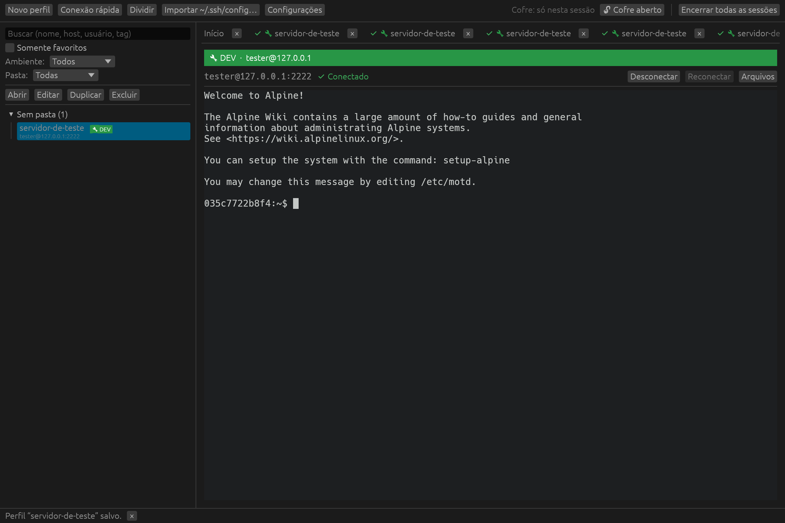
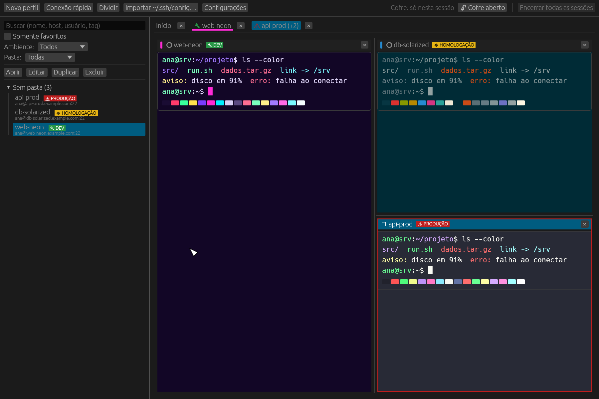
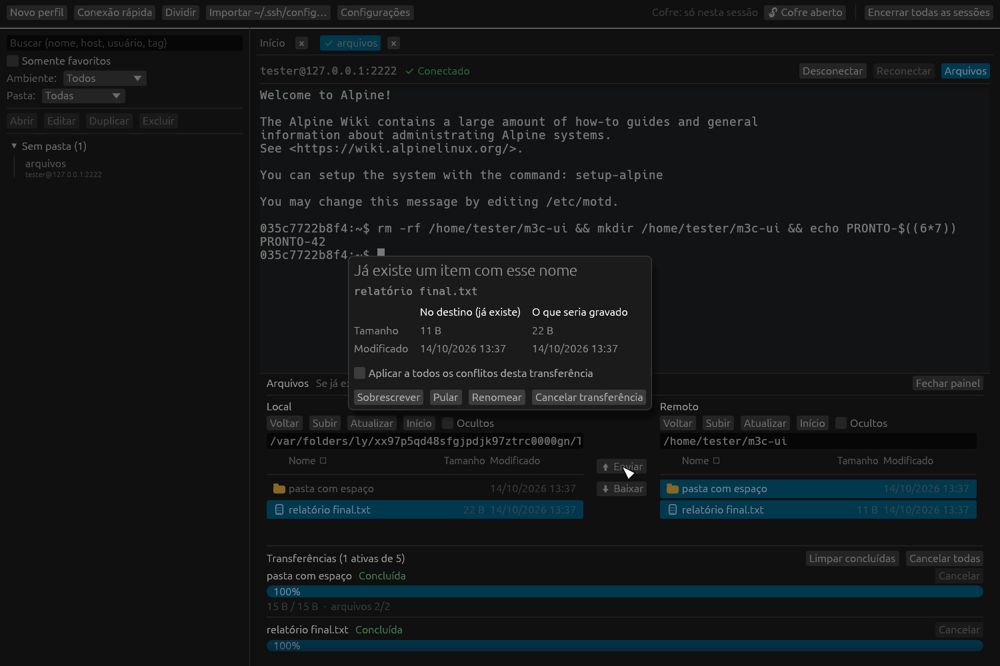
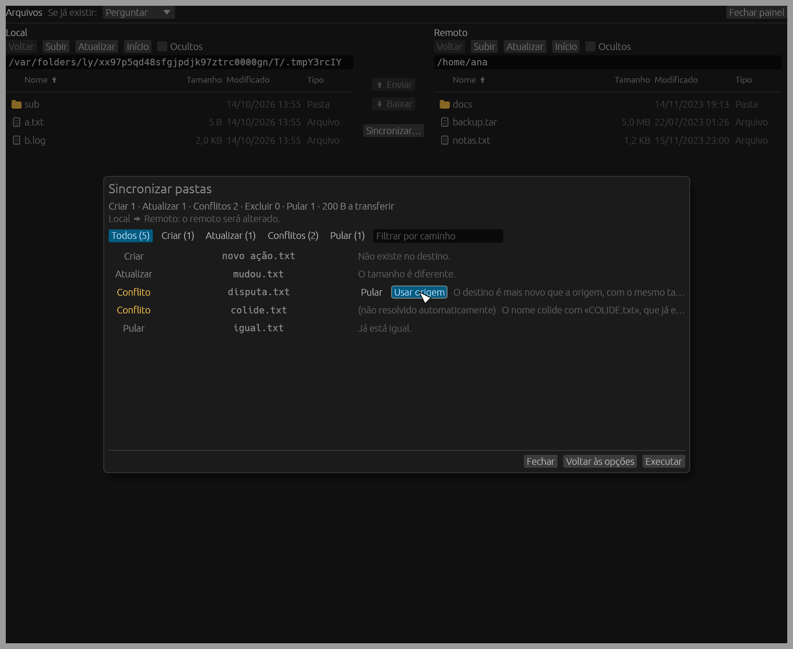

# mySSH

Gerenciador desktop de sessões SSH escrito em Rust (macOS, Windows e Linux), com interface em pt-BR. Sem telemetria e sem verificação automática de atualização: a única rede usada é a das conexões que você iniciar.

> Estado: versão 0.1.0, validada **apenas em macOS arm64**. Windows e Linux têm CI e empacotamento preparados, mas nunca foram executados (ver `docs/VALIDACAO.md`). Os pacotes são **sem assinatura**.

## Recursos
- Perfis (pastas, tags, favoritos, ambiente DEV/HOMOLOGAÇÃO/PRODUÇÃO com faixa de aviso) em SQLite, e conexão rápida sem salvar.
- Autenticação por senha, chave (com ou sem passphrase), agente SSH e keyboard-interactive/MFA.
- Segredos no cofre do sistema (Keychain, Credential Manager, Secret Service); nada em texto puro no disco.
- Validação estrita de host key (aceitar uma vez, aceitar e salvar; chave alterada bloqueia a conexão).
- Jump host, abas, painéis divididos e tema por perfil (6 paletas de terminal).
- Terminal próprio (alacritty_terminal) com colagem multilinha confirmada.
- Painel de arquivos SFTP (local e remoto, fila, conflitos, cancelamento, retomada de arquivos grandes).
- Sincronização unidirecional de pastas com prévia, exclusões desligadas por padrão e modo espelho protegido.
- Importação limitada de `~/.ssh/config` e exportação/importação da configuração em JSON (sem segredos).

## Capturas
| | |
|---|---|
|  |  |
|  |  |

Os dados dos renders são fictícios (servidor de teste local).

## Uso
Ver [`docs/USO.md`](docs/USO.md). Onde ficam os dados: [`docs/DADOS.md`](docs/DADOS.md).

## Compilar e executar
Requer Rust estável (edição 2024). No Linux, instale as bibliotecas de janela/GPU (veja `.github/workflows/ci.yml`).
```
cargo run -p myssh-app --release
```
Variáveis de ambiente úteis (nenhuma reduz a segurança):
- `MYSSH_DATA_DIR=dir`: usa outro diretório de dados. Com ela o cofre passa a ser **somente em memória** (nunca toca no cofre real).
- `MYSSH_MEMORY_VAULT=1`: cofre somente em memória, mantendo o diretório de dados.

Os ganchos de demonstração (`MYSSH_DEMO_SHOTS`, `MYSSH_DEMO_SSH`, `MYSSH_DEMO_KEY`; este modo aceita a host key sozinho) existem apenas em builds de debug, nos testes ou com `--features demo`. O build release padrão não os contém (verificado com `strings`).

## Testes
```
cargo fmt --all && cargo clippy --workspace --all-targets -- -D warnings && cargo test --workspace
```
Testes com servidor SSH real (Docker):
```
./testenv/up.sh        # 127.0.0.1:2222 (somente desenvolvimento)
MYSSH_TEST_SSH=127.0.0.1:2222 MYSSH_TEST_KEYS=$PWD/testenv/keys \
  cargo test --workspace -- --ignored --test-threads=1
```
`real_saida_dos_testes_sem_segredos` precisa de `MYSSH_TEST_LOG` (ver `docs/M1-RESULTADO.md`). Detalhes do testenv em `AGENTS.md`.

## Empacotamento
Usa [cargo-packager](https://github.com/crabnebula-dev/cargo-packager) (`cargo install cargo-packager --locked`):
O cargo-packager **não compila**: empacota o que já está em `target/release`. Compile antes, sem features:
```
cargo build --release -p myssh-app
cargo packager --release -p myssh-app --formats app,dmg      # macOS (testado)
cargo packager --release -p myssh-app --formats nsis,wix     # Windows (não testado)
cargo packager --release -p myssh-app --formats deb,appimage # Linux (não testado)
```
Saída em `target/release/` (ou `--out-dir`). No macOS arm64: `mySSH.app` e `mySSH_0.1.0_aarch64.dmg` (~12 MB).
O workflow `.github/workflows/release.yml` faz isso nos três SOs. **Os artefatos não são assinados nem notarizados**: no macOS o Gatekeeper avisará; veja "Primeira abertura" em `docs/USO.md`. No Windows, o SmartScreen avisará.

## Limitações conhecidas
- Windows e Linux não validados; IME e teclas mortas não validados em teclado real; VoiceOver não validado.
- Sem continuidade de sessão por conta própria: reconectar abre uma nova sessão (use tmux/screen no servidor).
- Dependência transitiva com advisory conhecido (RUSTSEC-2023-0071, RSA/Marvin): prefira chaves ed25519 (`docs/VALIDACAO.md`).
- Rename remoto no SFTP não é atômico quando o destino existe; symlinks não são transferidos.

## Licença
MIT OR Apache-2.0.
